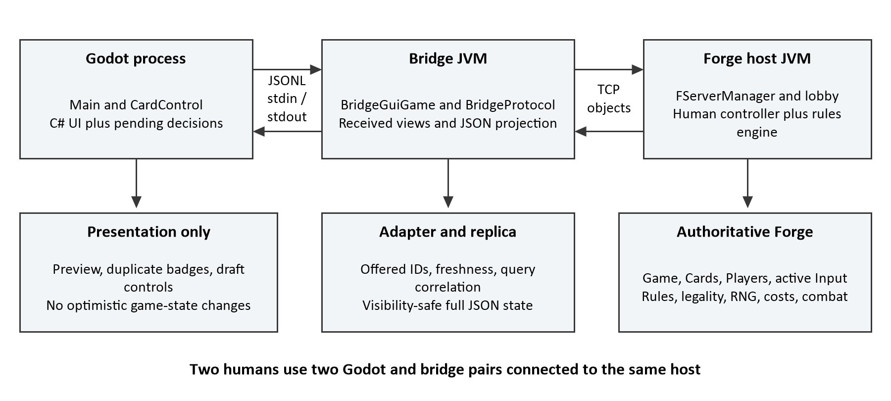
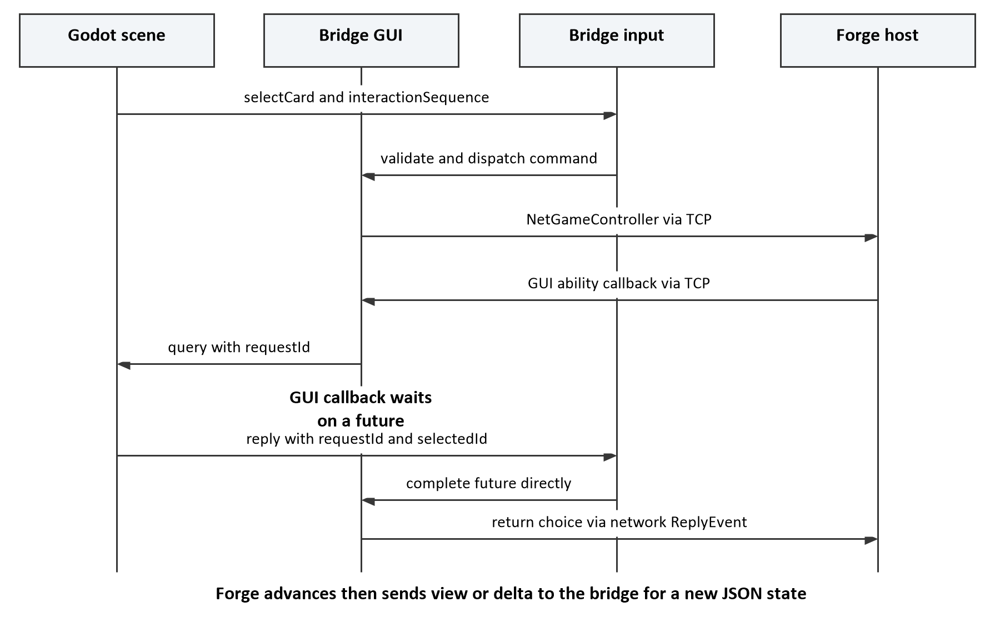

# MTG Premodern Client Developer Guide

Architecture gameplay tracing and a one week learning plan

This guide is for a developer who knows Magic, Java, C#, and client/server basics but is new to this repository. The project is a focused Godot client backed by the existing Forge rules engine. Learn the integration boundaries first: most visible bugs require tracing a decision across presentation, a local process bridge, Forge networking, and a host controller.

The practical goal is to run a game, explain the system, trace an action, diagnose a failure, and make a small change safely within seven sessions of about two hours each. Sections 1 through 7 explain the system. Section 8 turns that material into a learning plan. Section 9 is a desk reference and self-assessment; model answers and longer commands follow in appendices.

Repository baseline: inspected on 6 October 2026, branch `spike/godot-bridge`, HEAD `47c6eb86c4d4002b7b24a0958c26f2cf6347de56`. The working tree already contained an edited `PROJECT_STATUS.md` and untracked `.codex/`, `docs/MTG_INTERVIEW_STUDY_GUIDE.md`, and `docs/TWO_HUMAN_SLIGH.md`. Those files were preserved. Claims below describe the inspected checkout, including its existing local documentation.

Evidence labels: **Verified in code** means the named implementation establishes the behavior. **Executed** means a command or runtime check was run during this investigation. **Inference** means a conclusion from the design without a full runtime demonstration. **Unverified** marks a remaining limit. Source paths are relative to the repository root; symbols are the durable navigation anchors.

## How to use this guide

- Read Sections 1 and 2 before opening a debugger.
- Use Section 3 to build and demonstrate the two-human fixture.
- Follow Section 5 with the relevant source files open side by side.
- Keep Sections 4 and 7 nearby while diagnosing an interaction.
- Work through one day of Section 8 at a time, answering its questions from memory.

## Contents

1. The project in five minutes
2. Architecture and repository map
3. Startup and development workflow
4. Communication protocol and state flow
5. Trace real gameplay actions end to end
6. Important implementation details
7. Testing and debugging
8. One week learning plan
9. Quick reference and self-assessment
Appendix A: Model answers

Appendix B: Commands and evidence ledger

# 1 The project in five minutes

## What this application does

The custom application presents a one-versus-one Magic game in Godot and submits a human player's inputs to a Forge host. Forge owns rules, legal choices, shuffling, costs, targeting, priority, combat, and outcomes. The Godot client is deliberately narrow: development currently centers on the exact 60-card Sligh mirror in `forge-gui-desktop/src/test/java/forge/net/SlighMirrorDeck.java`, not arbitrary Premodern decks.

The initial hypothesis that Godot talks TCP/JSONL directly to Forge needs one correction. Godot launches a separate bridge JVM and exchanges JSONL through that process's stdin and stdout. The bridge is a Forge network client. It connects by TCP to another JVM hosting the authoritative game. The TCP payload is Forge's binary Java-object protocol, not JSONL.

## What a player can currently do

Verified in code: the UI displays life, hand counts, the local visible hand, both battlefields and graveyards, turn, phase, priority, stack descriptions, and combat relationships. A player can use offered Keep/Mulligan and Play/Draw controls, select cards and players, pass priority, answer ability and generic choice queries, order complete lists of items, and edit structured combat damage. Right-click opens a card preview when local artwork is available.

Two human clients now have a development host: `GodotTwoHumanSlighHostMain.main` opens two remote seats and starts when both distinct bridges are ready. The existing single-client `GodotSlighMirrorHostMain` still puts Forge AI in the other seat. Executed: the two-client Godot probe completed opening choices and shared land play during this investigation. This is evidence for that limited route, not evidence for every Sligh interaction or a full game through lethal.

Important limits remain. `BridgeGuiGame.finishGame` is empty, and `BridgePrinter.StateMessage` has no winner or game-over field. The displayed life total is not a result screen. Several required GUI callbacks remain unsupported, including general amount assignment, free text/dialog choices, sideboarding, and entity-choice callbacks. There is no custom deckbuilder, matchmaking service, or complete client lobby/rematch workflow in this slice.

## Why the three components exist

The host runs Forge's existing game model and human-input machinery. The bridge loads Forge resources so it can deserialize its views, implements a headless GUI adapter, and translates callbacks into a small, visibility-safe protocol. Godot gives the project its own board, reusable card visuals, and human controls. These are process and API boundaries; the bridge's local `GameView` is a received replica, not another authoritative game.

An action makes a round trip. A card control emits an event; `Main.OnCardPressed` sends a Forge card ID with the current interaction sequence. `BridgeProtocol` parses it; `BridgeGuiGame.handleCommand` checks the current context and offered card maps. `NetGameController` forwards the selection to the host's `PlayerControllerHuman`. Forge's active input object interprets that selection, and the engine advances if the action is valid. Network state callbacks reach the bridge, which emits a projected state. `Main._Process` applies it and rebuilds the visible controls.

## A concise developer explanation

"This is a Godot C# presentation client for a Forge-hosted Magic game. Each client owns a Java bridge process. JSONL crosses the local process boundary; Forge's TCP protocol crosses the host boundary. Forge decides what the human may do and owns all rules and state transitions. The bridge projects safe views and correlated decisions, and Godot renders them and returns input. Our current compatibility target is the exact Sligh mirror, with two-client opening and land-play coverage and further full-match work still needed."

# 2 Architecture and repository map



Figure 1. One human client has three processes in its development setup. Two humans share one host and each add a Godot process and a bridge JVM, for five processes total. Rules and the host controller share the host JVM.

## Component responsibilities

| Component | Owns and depends on | Entry and first reading |
|---|---|---|
| Godot client | Scene nodes, visual selections, previews, protocol records, pending-send status; depends on Godot .NET and the bridge JAR | `premodern-client/project.godot`; `Main.tscn`; `Main._Ready`, `_Process`, `RenderUi` |
| Process transport | Child JVM lifecycle, stdout/stderr readers, outbound queue; depends on .NET Process and Channels | `premodern-client/Bridge/BridgeProcessClient.cs`: `Start`, `TrySend`, `Dispose` |
| Bridge adapter | Received Forge views, offered-ID maps, JSONL projection and query correlation; depends on `forge-gui` and Gson | `forge-bridge/.../BridgeMain.java`, `BridgeSession`, `BridgeGuiGame`, `BridgeProtocol`, `BridgePrinter` |
| Forge network | Lobby seats, controller RPC, serialization, tracked views and deltas; depends on Netty and LZ4 | `forge-gui/.../gamemodes/net`: `FGameClient`, `NetGameController`, `RemoteClientGuiGame`, `GameProtocolHandler` |
| Host and input | Match creation and active human inputs; depends on Forge model, GUI interfaces, and rules modules | `GameLobby.startGame`, `HostedMatch`, `PlayerControllerHuman`, `InputProxy` |
| Rules and card data | Authoritative cards, players, stack, phases, rules operations and RNG; depends on `forge-core` | `forge-game/.../Game.java`, `GameAction`, `phase/PhaseHandler`; `forge-gui/res/cardsfolder` |

In this table and later references, `forge-bridge/.../` means `forge-bridge/src/main/java/forge/bridge/`; `forge-gui/.../` means `forge-gui/src/main/java/forge/`. Test hosts live under `forge-gui-desktop/src/test/java/forge/net/`, not a production launcher directory.

## Focused repository map

`forge-core`, `forge-game`, `forge-ai`, `forge-gui`, and `forge-gui-desktop` are the Forge module structure inherited by this fork. Treat them as existing engine/platform code with local integration changes, not untouched vendor binaries. Local changes include networking, London mulligan handling, and `CombatDamageAssignment`. `forge-bridge` and `premodern-client` are the focused custom integration/client surfaces. External libraries are declared in Maven POMs or the Godot SDK project; they are not a second custom rules implementation.

`forge-gui/res` supplies card scripts, editions, localization, preferences/default resources, and other Forge assets. `SlighMirrorDeck.create` resolves card names through `FModel.getMagicDb().getCommonCards()` and constructs a `Deck`; this fixture does not read a `.dck` file. The repository also contains many upstream Forge deck/resources unrelated to the current onboarding path.

`premodern-client/Protocol` holds records, parser, serializer, and client-state reducer. `Presentation` contains pure C# identity and combat-label helpers. `CardControl.cs` and `.tscn` are shared by hand and battlefield rendering. `premodern-client-tests` links protocol/presentation source directly into a console test executable; it does not require Godot scene execution. `premodern-client/tests` contains the GDScript scene-level probe and its PowerShell runner.

Generated artifacts live in Maven `target`, .NET `bin`/`obj`, and Godot `.godot`. Do not edit them. Local `premodern-client/card-images/**/*.webp` artwork is intentionally ignored. The root `README.md` describes Forge broadly; use client documentation and source for this integration's capabilities.

## Four kinds of state you must distinguish

| Kind | Example | Meaning |
|---|---|---|
| Authoritative engine state | Host `Game`, `Card`, `Player`, active input and stack | Forge's rules state; only engine/controller execution changes it |
| Received game projection | Bridge `GameView`; Godot `BridgeClientState.LatestState` | Replica and safe snapshot used to display the current game |
| Pending decision or command | `PendingQuery`, `PendingAsyncCommand`, bridge pending futures | Coordination state: who must answer and which context applies |
| Local presentation state | Preview texture, search text, selected ordering row, duplicate badge | UI convenience; it cannot establish game legality or move a card |

`RecordCommandSent` changes pending/status state, not zones. `actionAccepted` means the bridge forwarded an allowed command; it is not a host rules verdict. `NetGameController.selectCard` even returns `true` after sending, by design, rather than waiting for host success. Inspect the later state and interaction to establish what happened.

## Ordered reading path

1. `AGENTS.md`, then `PROJECT_STATUS.md`, client `README.md`, and `docs/TWO_HUMAN_SLIGH.md`. Learn the invariants and run route; cross-check the stale statements noted below.
2. `project.godot`, `Main.tscn`, and `Main._Ready`/`_Process`. Locate the actual scene entry and UI-thread handoff.
3. `BridgeProcessClient.Start` and `TrySend`. Establish that the local transport is child-process I/O.
4. `BridgeMessages`, `BridgeCommands`, `BridgeProtocolParser`, and `BridgeClientState.Apply`. Learn the data contract and pending-state rules.
5. `forge-bridge/PROTOCOL.md`, then `BridgeMain.main` and `BridgeSession.run`. See initialization, lobby assignment, readiness, and lifecycle.
6. `BridgeGuiGame.handleCommand` and `BridgePrinter.snapshotState`/`snapshotCard`. Find validation, projection, and privacy boundaries.
7. `BridgeProtocol.queryAbility`, `queryGenericChoices`, `handleInput`, `handleReply`. Learn the distinct async-action and blocking-query paths.
8. `NetGameController`, `GameProtocolHandler.channelRead`, `GameServerHandler.getToInvoke`, and `PlayerControllerHuman.selectCard`. Follow the real host route rather than stopping at the JSON boundary.
9. `InputProxy.selectCard`, `InputPassPriority.onCardSelected`, `InputSelectTargets`, `InputBlock`, and the matching tests. Read only the active workflow's input implementation first.
10. `NetworkGuiGame.applyDelta`, `RemoteClientGuiGame.updateGameView`, and `TrackableSerializer`. Study replica mechanics after the basic round trip makes sense.

## Documentation that needs careful interpretation

`PROJECT_STATUS.md` identifies a September 4 baseline and says a two-human arrangement is still required; the current checkout contains `GodotTwoHumanSlighHostMain`, `TwoHumanSlighBridgeIntegrationTest`, username overrides, and the two-client Godot probe. Its statement that no Godot executable was available describes that earlier verification session. A Godot executable was available and the land probe ran during this investigation.

The client `README.md` remains useful for G3 and Sligh-versus-AI, but its simple Pass Priority description omits the current `interaction.Reason == "buttons"` gate in `Main.RenderInteraction`. Its instructions to choose an offered ability can also be bypassed by the current sole-ability fast path. `PROTOCOL.md` correctly distinguishes JSONL and Forge TCP; use code for callback-specific fallbacks. Historical JSON-test failure notes in status are not current test results.

# 3 Startup and development workflow

## Prerequisites and configuration

Verified configuration: the Maven version is `2.0.14-SNAPSHOT`; Java compiler source, target, and release are 17. The parent enforcer requires Maven 3.8.1 or later and Java 17-compatible tooling. The client uses `Godot.NET.Sdk/4.7.1` and targets `net8.0`; an Android condition changes the target to `net9.0`, but Android packaging is not established by the desktop path. Use Godot's .NET build, not the standard non-C# editor.

Executed here: Oracle Java 17, Maven 3.9.16, and a .NET build using SDK 10.0.401 targeting the project's .NET 8 framework. The standalone presentation tests also ran. The installed Godot .NET 4.7.1 executable ran the headless probe. These are the observed tools, not requirements to upgrade to .NET 10.

Important dependencies include Gson 2.10.1 in the bridge, TestNG 7.10.2 for Java tests, Netty 4.1.115.Final and `lz4-java` 1.10.2 in `forge-gui`, and Guava 33.3.1-android in `forge-core`. C# JSON uses `System.Text.Json`; process I/O uses `System.Diagnostics.Process` and `System.Threading.Channels`. Maven Assembly packages dependency JARs with the bridge main class. The desktop artifact also packages Forge dependencies needed by test hosts.

`Main` exposes `JavaExecutable`, `BridgeJarPath`, `AssetsDirectory`, `Host`, `Port`, and `Username` as Godot `[Export]` properties. Select the root Main node in the editor Inspector to change them. Defaults are `java`, the bridge fat JAR below, `../forge-gui`, and `localhost:36743`. Relative JAR/assets paths are resolved against the Godot project directory, even though the child JVM working directory is the repository root.

## Build from the repository root

The commands below are Windows PowerShell commands. `--%` is PowerShell's stop-parsing marker for Maven arguments; do not copy it into a Bash command. The package command compiles test classes while skipping test execution; the development host is loaded from `target/test-classes`.

```powershell
mvn --% -pl forge-gui-desktop,forge-bridge -am -DskipTests package
dotnet build "premodern-client/Premodern Client.csproj" -nologo
dotnet run --project premodern-client-tests/PremodernClient.PresentationTests.csproj
```

Executed: both builds succeeded, the C# build had zero warnings/errors, and the console checks passed 52 assertions. Initial sandboxed builds could not resolve Maven's `wagon-ftp` extension or the NuGet Godot SDK. Reruns with access to the existing dependency sources succeeded. A dependency-resolution failure before compilation is not evidence of an application regression.

Expected JARs are `forge-bridge/target/forge-bridge-2.0.14-SNAPSHOT-jar-with-dependencies.jar` and `forge-gui-desktop/target/forge-gui-desktop-2.0.14-SNAPSHOT-jar-with-dependencies.jar`. Verify these names if the parent revision changes. `BridgeProcessClient.Start` checks JAR and assets-directory existence before starting Java; it does not validate all required contents of `res`.

## Start two human clients

Terminal 1, from the repository root:

```powershell
Push-Location forge-gui
java -cp "..\forge-gui-desktop\target\test-classes;..\forge-gui-desktop\target\forge-gui-desktop-2.0.14-SNAPSHOT-jar-with-dependencies.jar" forge.net.GodotTwoHumanSlighHostMain 36743
Pop-Location
```

The host working directory matters. `TestUtils.ensureFModelInitialized` installs `HeadlessGuiDesktop`, loads Forge's model/resources, disables deck-legality enforcement for these fixtures, sets English and UPnP NEVER, and uses delta sync by default. The host creates two exact Sligh decks and OPEN seats 0 and 1. Wait for `TWO_HUMAN_SLIGH_WAITING` before launching clients. The two-minute join timer is in the host.

Terminal 2, from the repository root; substitute your installed Godot .NET executable:

```powershell
$godot = "C:\Users\scott\Desktop\Godot_v4.7.1-stable_mono_win64\Godot_v4.7.1-stable_mono_win64_console.exe"
& $godot --path (Resolve-Path .\premodern-client).Path -- --username "Sligh Player A"
```

Run the same command in Terminal 3 with `Sligh Player B`. Arguments after `--` reach `OS.GetCmdlineUserArgs()`. `Main.ResolveUsername` trims the name and rejects empty names, line breaks, or repeated/missing-value `--username` arguments. The host rejects identical seat names. Arrival order determines seat assignment; use names and window titles rather than assuming terminal order is seat order.

The bridge claims an assigned lobby slot and marks itself ready. The host starts automatically after both independent remote clients are ready. Each bridge has a 30-second lobby-assignment wait; model/resource startup precedes that wait. The coin-toss winner answers Forge's offered Play/Draw buttons. Then each player answers Keep/Mulligan. Keep first; when appropriate, Forge later exposes London bottoming selection. Choose offered cards and confirm, or use Forge's Auto control.

This manual two-window launch is established by source and the headless equivalent; a visible two-window full game was not played during investigation. For a quick demonstration, show separate hands and opponent counts, play an offered land, and confirm the same battlefield/hand-count change in both windows. Close both clients to dispose their bridge children; press Enter in the host terminal to stop the host. Do not use a still-running host on port 36743 when invoking the probe, which owns its own host.

## Alternative fixtures and IDE actions

For one human versus Forge AI, replace the host class with `forge.net.GodotSlighMirrorHostMain`. For deterministic target/cost work use `forge.net.GodotG3HostMain`: Alice has Forests and Llanowar Elves; Bob has Mountains and Lightning Bolt. `GodotJackalPupCombatHostMain` provides a repeated-combat fixture. These launch routes are inspected; the land runtime probe is the executed Godot route recorded here.

In Godot, import `premodern-client/project.godot`, inspect Main's exported properties, and press F6 for the current Main scene or F5 for the configured project main scene. `project.godot` points to Main's UID and requests C# / GL Compatibility with a 2000 by 1200 viewport and canvas-item stretching. The scene is a Control-based UI, not a 3D board. In a Java IDE import the root Maven POM, use JDK 17, include desktop test sources, and set the host run configuration working directory to `forge-gui`.

Forge Desktop can also host the network lobby, with actionable-card highlighting enabled and an open human seat. Its UI launch/start flow was inspected in the client README but not manually exercised here. The two-human fixture is the most reproducible onboarding route. Platform behavior beyond this Windows checkout is unverified; Windows commands use semicolon classpaths and PowerShell syntax.

## Tests and logs

Use the focused commands in Appendix B. Run bridge tests for validation/query changes, desktop integration tests for the host/TCP path, and the C# console executable for its linked protocol/presentation mechanisms. Run the Godot probe for actual scene wiring. `dotnet test` is not the command for the console test project.

Godot's Output panel or console receives bridge stderr and `G2_OUTBOUND`, `G2_COMMAND_SENT`, `G3 CLICK`, `G3 QUERY_REPLY`, `G3 STACK`, `G3 ZONE`, and priority/resolution observations. Some prefixes are historical spike labels; they still log generic actions. Bridge stdout must stay JSONL-only. `BridgeMain.main` saves stdout for protocol output and redirects ordinary Forge stdout to stderr before initialization.

Maven reports are under the tested module's `target/surefire-reports`. Forge network files use `ForgeConstants.NETWORK_LOGS_DIR`, derived from the user profile as `USER_DIR/networklogs`; `ForgeConstants.LOG_FILE` is `USER_DIR/forge.log`. Consult `ForgeProfileProperties` for the actual active profile rather than assuming a fixed absolute path. `NetworkLogConfig` and `NetworkLogWriter` control instance/test routing. The Godot probe prints its retained temporary log directory containing host output/error and each client's output/error and Godot log.

# 4 Communication protocol and state flow

## Two transports with different contracts

`BridgeProcessClient.Start` owns the bridge process, redirects three streams, and starts reader/writer tasks. Its stdout task reads lines and queues parsed `BridgeMessage` records; stderr lines go to a separate diagnostic queue. `TrySend` serializes typed commands and enqueues them in an unbounded channel with one reader. The writer sends and flushes one line at a time. A successful enqueue is local transport acceptance, not engine execution.

The protocol specifies UTF-8. Java `JsonLineTransport` explicitly wraps stdin as UTF-8 and uses a dedicated input thread plus a queued output thread. Input framing is `BufferedReader.readLine`; each line must parse as a JSON object. Output is Gson serialization followed by `println` and flush on the supplied PrintStream. BridgeMain preserves System.out without explicitly replacing its charset, so encoding of non-ASCII output depends on JVM launch/platform settings; the ASCII-focused checks do not prove universal UTF-8 output. Malformed input becomes an `invalidJson` error. There is no exposed fixed JSONL frame-size/backpressure guarantee: both transport queues are unbounded in the inspected code. Keep protocol diagnostics out of stdout.

Forge TCP uses `FGameClient.connect` and a Netty `NioSocketChannel`. `CompatibleObjectEncoder` writes a four-byte big-endian length followed by an LZ4-compressed Java serialization stream. `CompatibleObjectDecoder` uses `LengthFieldBasedFrameDecoder` and the matching object stream; TCP packet boundaries therefore have no semantic role. `GuiGameEvent` carries a `ProtocolMethod` and arguments; `ReplyEvent` completes a Forge `ReplyPool`. That correlation is separate from JSON `requestId`. Heartbeat writes are configured at 15 seconds by default through `forge.net.heartbeatInterval`.

## JSONL messages a newcomer needs

All messages require integer `schemaVersion: 1`. The Java sender adds it; the C# serializer adds it independently. Do not silently reinterpret a schema-v1 field. Direction below is relative to Godot and its bridge.

| Direction | Type or kind | Purpose and important fields |
|---|---|---|
| Bridge to Godot | `lifecycle` | `event`, `detail`: model init, connecting, connected, ready, disconnect, EOF |
| Bridge to Godot | `controller` | Local `playerId`, `playerName`, interface/implementation diagnostics |
| Bridge to Godot | `state` | `source`, `stateSequence`, turn/phase/priority, players, stack, combat |
| Bridge to Godot | `interaction` | `interactionSequence`, reason, prompt, offered card/player IDs, highlighted IDs, min/max, buttons |
| Bridge to Godot | `query` / `abilityChoice` | `requestId`, host card, ability choices with integer IDs, description, canPlay |
| Bridge to Godot | `query` / `genericChoice` | `requestId`, prompt, min/max, opaque `optionId` values and labels |
| Bridge to Godot | `query` / `itemOrdering` | Opaque item IDs, original order, descriptions, optional source card, remember flag |
| Bridge to Godot | `query` / `combatDamageAssignment` | Ordered recipient keys, player/card entity IDs, damage and constraints |
| Bridge to Godot | `reveal`, `error`, `actionAccepted` | Informational reveal; structured rejection; forwarding acknowledgement |
| Godot to bridge | `selectCard`, `selectPlayer` | Offered card/player ID plus current `interactionSequence` |
| Godot to bridge | `button`, `passPriority` | Button is `ok` or `cancel`; Forge labels may differ; current sequence |
| Godot to bridge | `reply` | `requestId` plus selectedId, selectedOptionIds, orderedItemIds, or assignments/skip |

Read `BridgeProtocol`'s message records with C# `BridgeMessages.cs`, `BridgeProtocolParser.cs`, and `BridgeCommands.cs` open. Java Gson normally omits null record fields, so clients cannot rely on a null field being explicitly present. The C# parser supplies several missing-field defaults, catches parse exceptions into `ProtocolProblemMessage`, and preserves unknown types as `UnknownBridgeMessage`; it is not an exhaustive protocol conformance validator.

## State snapshots and identity

Forge first establishes a full `GameView`; later it normally sends `DeltaPacket` updates. `NetworkGuiGame.applyDelta` resolves typed tracked-object IDs, creates referenced objects before applying properties, dispatches associated events, and checks a supplied checksum. Checksum mismatch can request a Forge full-state resync. This reconstruction happens in Java, not Godot.

After either full or delta callback, `BridgeGuiGame.observeState` calls `BridgePrinter.state` on the whole current replica. Every JSON `state` is a full projection of the fields the client consumes. `source: "delta"` tells you what triggered projection; it does not mean the JSON is a patch. `BridgeClientState.Apply` replaces `LatestState` rather than merging a JSON delta.

Card/player/ability/stack IDs are Forge view identities. A printed name is display data and is unsafe as an object key because multiple copies can share it. `Main.FindLocalPlayer` matches `Controller.PlayerId` against state players. To trace a displayed card, read its tooltip/log ID, find that ID in the snapshot and the current offered IDs, then inspect the bridge map and host `InputProxy` resolution through `PlayerControllerHuman.getCard`. Forge tracking and typed IdRefs carry identities across TCP. Do not manufacture an ID from a local image filename or duplicate badge.

The JSON state projects local visible hand entries, hand counts, battlefield and graveyard cards, stack source/target cards, and combat attacker-to-blocker IDs. It does not expose the entire Forge view: library contents, every zone, full mana pool, all card characteristics, player stack-target details, and game results are not part of this state record. A missing field may be a projection limit rather than absent engine behavior.

Visibility is applied in `BridgePrinter.snapshotCard`: only cards shown to a local player get names, tapped information, and `isLand`. `handVisible` drops hidden entries entirely. Opponent hand counts remain available without identities. Selection-card IDs are also filtered by `canBeShownToAny(localPlayers)`. Hidden public-zone entries can retain an ID/zone with `hidden: true`; Godot must not use that to infer identity/type or request artwork.

## The three correlation fields

`stateSequence` is Forge ordering metadata from full/delta callbacks; `-1` means no sequence was supplied. Clients do not echo it. The current C# reducer stores messages in dequeue order and has no stale-state rejection based on this number. Do not claim it provides an enforced client ordering guarantee.

`interactionSequence` is incremented for each emitted cumulative interaction snapshot. Button, prompt, selectable, and highlight callbacks can each advance it. It is not a turn number or per-card ID. Async actions must echo the current sequence. `BridgeGuiGame.handleCommand` rejects mismatch/zero as `STALE_INTERACTION`, then checks offered IDs or enabled buttons. A newer interaction can invalidate an old click even if the card still appears on the board. No automatic retry is performed.

`requestId` is a bridge-generated `q-N` for a synchronous query and its reply. Offered ability IDs map to original views; `option-N` and `item-N` are request-local opaque identities, preserving even identically labelled items. Replies must match a pending query. `staleRequestId` means there is no matching request. Do not attach an interaction sequence to a reply or use a request ID for normal card clicks.

## Short examples

The reply shape below comes from `AbilitySelectionBridgeTest.Harness.reply`; ID values are illustrative substitutions. The first two lines are deliberately malformed variants constructed from that shape. Each is one line in transit:

```json
{"type":"reply","requestId":"q-1","selectedId":17}
{"schemaVersion":999,"type":"reply","requestId":"q-1","selectedId":17}
{"schemaVersion":1,"type":"reply","requestId":"q-1","selectedId":17}
```

The first produces `MISSING_SCHEMA_VERSION`; the second produces `UNSUPPORTED_SCHEMA_VERSION`. The last shape is accepted only if ID 17 is actually offered for that pending query. Literal numbers here are illustrative, not identities from your current game.

The following compact exchange is illustrative, constructed to match `BridgePrinter` and `BridgeCommandSerializer`. It depicts an offered card and a correlated click; line wrapping on the page is for readability, not transport framing.

```json
{"schemaVersion":1,"type":"interaction","interactionSequence":42,
 "reason":"buttons","prompt":"Choose a card",
 "weaklySelectableCardIds":[123],"selectableCardIds":[],
 "combatSelectableCardIds":[],"highlightedCardIds":[],
 "selectablePlayerIds":[],"min":0,"max":0,
 "buttons":{"okLabel":"OK","cancelLabel":"End Turn",
 "okEnabled":true,"cancelEnabled":true,"focusOk":true}}
{"schemaVersion":1,"type":"selectCard","cardId":123,
 "interactionSequence":42}
```

Generic-choice exchange, illustrative and matching the protocol records:

```json
{"schemaVersion":1,"type":"query","requestId":"q-8",
 "kind":"genericChoice","prompt":"Choose a card name",
 "min":1,"max":1,"options":[
 {"optionId":"option-1","label":"Mountain","selected":false}]}
{"schemaVersion":1,"type":"reply","requestId":"q-8",
 "selectedOptionIds":["option-1"]}
```

## Errors disconnects and thread handoffs

Async commands are parsed on Java's JSON input thread, then dispatched to `BridgeGuiBase`'s single GUI executor. Forge network GUI callbacks also use the GUI-thread dispatch path. A synchronous callback may block that executor waiting on a `CompletableFuture` for up to 30 seconds. Crucially, JSON replies are handled directly by the separate input thread and complete the future; routing replies through the blocked executor would deadlock.

Generic-choice, ordering, and combat-damage validation errors re-emit the same pending query after an error, without starting a fresh timeout budget. Invalid ability selectedId emits `invalidQueryChoice` without re-emitting its query. In Godot the panel is cleared when a reply is recorded as sent; therefore the ability error path can leave the current panel unavailable. Treat this asymmetry as existing behavior and a debugging lead, not a guarantee that every invalid reply is equally recoverable.

Timeout handling differs by callback: item ordering preserves the original Forge-provided order, while a failed required generic choice throws and stops the session. Ability failure also signals required-query failure; combat damage returns null after timeout/cancellation, with interpretation dependent on the caller. `BridgeProtocol.close` completes pending futures exceptionally. Never replace required choices with arbitrary local selections.

Godot readers never touch nodes. `Main._Process` drains diagnostics and messages on the scene thread, calls `Apply`, then `RenderUi`. `_ExitTree` disposes the child: close stdin, wait up to three seconds, then kill the process tree if necessary. EOF stops the bridge session. Network channel closure emits a disconnected lifecycle and releases its stop latch. There is no automatic bridge/client reconnect or transparent action replay in this slice, although Forge's server code has reconnect machinery.

# 5 Trace real gameplay actions end to end



Figure 2. A selection and a subsequent synchronous choice cross both transport boundaries. The JSON input reader can complete the choice while the bridge GUI callback waits. State returns through a separate projection route.

## Workflow one Start a match and display an opening hand

1. **Player/start action.** Run `GodotTwoHumanSlighHostMain.main`, then launch two Main scenes with distinct usernames. The host loads resources through `TestUtils.ensureFModelInitialized`, creates both decks with `SlighMirrorDeck.create`, and configures OPEN slots.
2. **UI handler.** `Main._Ready` binds `%` scene nodes, loads `CardControl.tscn` and artwork, resolves paths/username, sets the window title, and calls `BridgeProcessClient.Start`.
3. **Outgoing call.** Process arguments select host, port, username, and assets. `BridgeMain.main` installs `BridgeGuiBase` before Forge classes consult assets, initializes `FModel`, and enters `BridgeSession.run`.
4. **Receiving lobby.** `FGameClient.connect` establishes TCP and its login/lobby handlers receive assigned state. `BridgeSession.LobbyListener.update` records the local slot; `sendReady` sends `UpdateLobbyPlayerEvent.isReadyUpdate(true)`.
5. **Forge match creation.** The host's readiness loop calls `GameLobby.startGame` and runs the returned Runnable. Forge's HostedMatch/controller path creates and starts the game. For two humans the winner's Play/Draw choice is an `InputConfirm`, exposed through ordinary buttons.
6. **Returning messages.** `GameClientHandler.beforeCall(openView)` creates `NetGameController` for the local player. `BridgeGuiGame.setOriginalGameController` emits `controller`. Full/delta callbacks call `observeState`; `BridgePrinter.snapshotState` includes safe hand projections. Prompt/button callbacks emit `interaction`.
7. **Client handling.** `ReadStdoutAsync` queues parsed messages. `Main._Process` applies them; `FindLocalPlayer` uses controller player ID, not seat/name guessing.
8. **Visible update.** `RenderUi` fills headers and local hand using `RenderImageCards`; opponent hand is a count. `RenderInteraction` labels controls with Forge's current Play/Draw, Keep/Mulligan, or bottoming controls. The runtime probe asserts seven own hand controls, opponent count seven, Keep, and shared land state.

Mulligan is an extension of this trace. `MulliganService.runPlayerMulligans` asks keep/mulligan; post-mulligans invoke `LondonMulligan.afterMulligan`. `PlayerControllerHuman.tuckCardsViaMulligan` runs `InputLondonMulligan`. That input publishes the actual hand as selectables and toggles highlights for selected cards. Its OK becomes enabled at the required count; Auto uses the cancel controller slot with a Forge-specific label. Forge, not Godot, moves returned cards to the library bottom.

## Workflow two Play a land

1. **Action.** At main-phase priority, click a Forge-offered Mountain in hand. `CardControl._GuiInput` emits `PrimaryActionRequested` only for a completed left click over its visual with primary action enabled.
2. **UI handler.** `Main.RenderImageCards` bound the card ID and rendered interaction sequence into that signal handler. `OnCardPressed` logs the selection and calls `SendAsyncCommand(new SelectCardCommand(...))`.
3. **JSON.** `SendAsyncCommand` checks the captured sequence against the rendered sequence. `SendCommand` calls `BridgeProcessClient.TrySend`, then records pending command status. `BridgeCommandSerializer.Serialize` produces `selectCard`, cardId, schemaVersion, and interactionSequence.
4. **Bridge receive.** `JsonLineTransport.readInput` calls `BridgeProtocol.handleInput`; it validates the envelope and dispatches a typed command. `BridgeGuiGame.handleCommand` rejects a stale sequence or unoffered ID, then calls `gameController.selectCard(card, null, null)`.
5. **Host decision.** `NetGameController.selectCard` sends `ProtocolMethod.selectCard` in a `GuiGameEvent`. `GameServerHandler.getToInvoke` resolves the controller for the remote seat. `PlayerControllerHuman.selectCard` delegates to `InputProxy.selectCard`, which resolves a real Card and invokes the current input. During priority, `InputPassPriority.onCardSelected` obtains possible abilities and calls `PlayerControllerHuman.getAbilityToPlay`.
6. **Rules advance.** The GUI ability callback traverses `RemoteClientGuiGame` to the bridge. A sole ability with null trigger event returns directly; multiple choices use a correlated query. The chosen ability stops the priority input; `chooseSpellAbilityToPlay` returns it and `playChosenSpellAbility` invokes `PlaySpellAbility.playSpellAbility`. Forge handles the land ability and publishes the resulting state.
7. **Return handling.** The bridge emits an acknowledgement for forwarding, plus later state/interaction callbacks. `Apply` stores the state and clears pending async state when it sees an accepted action followed by state, or a newer interaction context.
8. **Display.** `RenderUi` reads the new hand and battlefield. `RenderBattlefieldRows` separates lands using projected `IsLand`. Nothing removes a hand card when the click is first sent. The executed two-client land probe confirmed the acting hand count falls and both land rows reflect the same engine change.

Read `premodern-client/tests/TwoClientOpeningProbe.gd` for a practical UI exercise: it invokes the real miniature control's primary-action signal only when the card is offered, then observes the resulting rendered zones. The probe does not make normal shuffled land draws deterministic.

## Workflow three Cast a targeted spell and pass priority

Use G3 or `JsonBridgeIntegrationTest` for a repeatable Lightning Bolt route. A normal Sligh draw can also reach it, but should not be treated as deterministic.

1. **Action and UI.** Click the offered Bolt: the same `CardControl` to `OnCardPressed` path sends `selectCard`. There is no Bolt-specific action message or client spell rules.
2. **Host ability.** The priority input collects playable SpellAbility objects. `PlayerControllerHuman.getAbilityToPlay` caches view-to-engine mappings in `spellViewCache`. `RemoteClientGuiGame.getAbilityToPlay` synchronizes state and waits on the network callback. `BridgeGuiGame.getAbilityToPlay` takes the sole-ability fast path or `BridgeProtocol.queryAbility` emits `abilityChoice`.
3. **Optional query panel.** `Main.RenderAbilityQuery` creates buttons from offered descriptions/canPlay. `SendReply` sends `ReplyCommand(requestId, selectedId)`. `BridgeProtocol.handleReply` maps the offered ID to the original view and completes the future. Forge's network `ReplyEvent` returns it; `spellViewCache` resolves it back to the real SpellAbility.
4. **Targets and costs.** `PlaySpellAbility` establishes Forge's target/cost inputs. `InputSelectTargets` publishes card candidates and player candidates using `setSelectables` and `publishSelectablePlayers`. `BridgeGuiGame` exposes these as separate ID collections. A card target uses `OnCardPressed`; a player header uses `OnPlayerPressed` and `SelectPlayerCommand`. `InputProxy` resolves Card or Player as appropriate. Mana payment uses offered mana-source card selections through `InputPayMana` / `InputPayManaOfCostPayment` and the same generic selection route.
5. **Stack publication.** Once Forge has paid costs and placed the spell, the state projection contains stack text, source, and card targets. `Main.RenderUi` formats these through `FormatStack`. Player targets are selectable correctly even though the JSON stack-target list only contains target cards.
6. **Priority.** Click Pass Priority when enabled. `Main.OnPassPriority` sends the current sequence. `BridgeGuiGame.handleCommand` calls `NetGameController.passPriority`; the host's `PlayerControllerHuman.passPriority` acts on its current priority input. Godot's pass gate requires local priority and a buttons interaction; the bridge itself does not add a separate local-priority legality check.
7. **Resolution.** Forge resolves the stack and applies damage/state-based actions. Full/delta callbacks reach `BridgeGuiGame`; it reprojects current state. The source card leaves hand/stack as the engine dictates and a killed target enters the graveyard.
8. **Display and evidence.** `_Process` applies state and redraws zones, life, and stack; `LogG3Observation` records changes. The external JSON test exercises card, opponent, self, and Scroll scenarios; its driver is a test harness replacing Godot at the JSON boundary. Its success does not by itself validate Godot mouse/scene behavior.

## Workflow four Declare blockers and assign combat damage

1. **Action/UI.** During blockers, select an attacking creature to review its blockers, then a green offered blocker. `Main.RenderImageCards` uses `CombatSelectableCardIds` for attacker navigation, ordinary selectables for legal actions, and highlighted IDs for the current selection. These are distinct visual roles.
2. **Outgoing/receiving.** Both clicks are `selectCard` commands. `BridgeGuiGame.handleCommand` accepts cards from selectable, weakly selectable, or combat-navigation maps and forwards through `NetGameController` and host `InputProxy`.
3. **Authoritative input.** `InputBlock.onCardSelected` makes an attacker current, or toggles a legal block using `CombatUtil.canBlock`. It fires combat changes and republishes candidates. `InputBlock.onOk` validates the complete declaration with `CombatUtil.validateBlocks` before stopping. `InputAttack` is the matching attacker-declaration input.
4. **Projection/UI.** `BridgePrinter.snapshotCombat` reads `CombatView.getPlannedBlockers` for each attacker. `BridgeGuiGame.updateCombatSelectables` exposes attackers while the phase is DECLARE_BLOCKERS. Godot's `CombatPresentation` builds exact relationship labels from these received IDs; it does not add a local block when clicked.
5. **Damage query.** Forge's `PlayerControllerHuman.assignCombatDamage` and `RemoteClientGuiGame.assignCombatDamage` pass the attacker, blockers, damage, and actual GameEntityView defender to the bridge. `BridgeProtocol.queryCombatDamage` constructs the Forge-owned `CombatDamageAssignment` model. Zero/one-recipient cases can finish without a human query; multiple recipients become a `combatDamageAssignment` query.
6. **Human answer.** `Main.RenderCombatDamageQuery` builds numeric SpinBox controls. `ValidateDamageDraft` gives guidance using offered constraints; `SendCombatDamageReply` sends requestId, recipientKey/amount pairs, and optional skip. The bridge calls `CombatDamageAssignment.validate` before converting the answer with `toForgeResult` and completing the network callback.
7. **Engine result.** Defender recipients are typed `player` or `card` in JSON. Forge's legacy returned map represents defender damage by a null CardView key; the bridge converts to that convention rather than inventing a fake card. Forge then applies combat damage and rules consequences.
8. **Visible result/limit.** Later snapshots change life, zones, and combat relationships. Bridge tests verify trample assignment and engine combat tests cover related behavior. A two-human Godot Ball Lightning trample-to-lethal route was not executed in this investigation; treat it as a deliberate verification task, not a completed capability claim.

# 6 Important implementation details

## Godot concepts that matter here

A scene (`.tscn`) is a serialized node tree. `Main.tscn` attaches `Main.cs` to a root `Control`, a UI node with layout, size, input, and child ownership. `VBoxContainer`, `HBoxContainer`, and FlowContainer arrange child controls; `ScrollContainer` provides constrained zone scrolling. Stable zone minimum sizes in the scene keep the board from collapsing when a zone is empty.

`_Ready` runs when the node and children are ready; it is where this client binds nodes and starts the bridge. `_Process(double delta)` runs every rendered frame and drains queued data before touching nodes. `_ExitTree` handles teardown. C# scripts are partial classes because the Godot source generator supplies engine glue. `[Export]` exposes properties in the Inspector. `[Signal]` defines events that Godot and C# can consume.

`GetNode<Label>("%ConnectionStatus")` uses a scene-unique name set by `unique_name_in_owner = true`; it is not a global lookup or a network ID. Renaming a node without updating the binding causes scene startup failure even when C# compiles. `PackedScene.Instantiate<CardControl>()` creates the reusable miniature tree. `res://` names project resources; `ProjectSettings.GlobalizePath` converts them to OS paths. `ResourceLoader.Load` loads imported engine resources, while `DirAccess` enumerates project asset files.

`CardControl._GuiInput` consumes mouse events with `AcceptEvent`. A left press/release emits a primary-action signal only when allowed and over the visual. Right press emits preview independently. Rotation is on `VisualRoot`, with a centered pivot and a larger stable square battlefield slot when tapped layout is enabled. A card's geometry and preview are visual behaviors; its legal action originates in received Forge offers.

## Bridge adaptation and visibility

`BridgeMain` must install its `IGuiBase` before initializing classes that read `ForgeConstants`. It saves original stdout, redirects Forge output, then initializes the card database. Changing initialization order can fail long before a player connects. The bridge needs Forge card resources for network PaperCard deserialization even though it does not own match rules.

Short excerpt from `BridgePrinter.snapshotCard`:

```java
boolean visible = localPlayers != null && !localPlayers.isEmpty()
        && card.canBeShownToAny(localPlayers);
boolean isLand = visible && card.getCurrentState() != null
        && card.getCurrentState().isLand();
```

This gates display identity and land grouping together. A hidden card must not leak its type through the land row or artwork. The subsequent CardSnapshot uses a null name and false tapped/type values when hidden. Never patch this with a known Sligh name or a guessed opponent card.

## Offers are capabilities not local rules

`PlayerControllerHuman.chooseSpellAbilityToPlay` computes actionable cards when highlighting is enabled, and `InputPassPriority.showNormalPrompt` publishes them. Targeting and combat inputs publish their own candidates. Weakly selectable cards normally indicate actions; strongly selectable cards indicate a bounded active selection; combat-selectable IDs support choosing which attacker to examine. Highlighted IDs indicate Forge's selected/current entities and do not independently grant actions.

The current UI enables actions using unions of received ID sets and `CanSendAsync`. That method requires a running bridge and no pending async command or synchronous query. `RenderInteraction` also uses current button flags and local priority. These gates protect the UX from duplicate or obviously stale input, while the bridge and engine remain responsible for validation. A valid current pass command still delegates legality to the active host input.

Short excerpt from `BridgeGuiGame.getAbilityToPlay`:

```java
if (triggerEvent == null && offered.size() == 1) {
    return offered.get(0);
}
```

This mirrors Forge Desktop's unambiguous selection behavior and avoids prompting for a lone mandatory trigger whose normal canPlay flag can be false. It is generic; it is not a Jackal Pup exception. Multi-option cases still preserve the player's choice. `AbilitySelectionBridgeTest` and `JackalPupTriggerRegressionTest` are the regression anchors.

## Blocking calls with an interactive UI

Short excerpt from `BridgeProtocol.queryGenericChoices`:

```java
pendingGenericChoiceQueries.put(requestId, pending);
send(query);
try {
    return pending.reply().get(queryTimeoutMillis, TimeUnit.MILLISECONDS);
} finally {
    pendingGenericChoiceQueries.remove(requestId, pending);
}
```

The original objects remain in the Java pending map, and only opaque IDs/labels cross JSON. The real implementation also handles timeout/interruption/cancellation before removal. The separate JSON input thread completes the future. Godot stays responsive because it polls message queues rather than waiting on a Java call. Long breakpoints in a query can consume the 30-second timeout; freeze related processes or use a controlled test timeout rather than interpreting that as a rules failure.

`BridgeGuiBase.invokeInEdtLater` serializes callback work on a headless executor; `invokeInEdtNow` runs directly, and background tasks use daemon threads. Do not infer that every Forge method is inherently thread-safe from the presence of this executor. The bridge offered maps rely on the intended callback/command dispatch route. Netty I/O, Forge game-thread work, headless GUI execution, JSON transport threads, and Godot's scene thread are different contexts.

## Pending state and redraw tradeoffs

Short excerpt from `Main._Process`:

```csharp
clientState.Apply(message);
// Logging observes the message here.
changed = true;
// After draining the queue:
if (changed) RenderUi();
```

The comment is explanatory; the source also calls logging methods between Apply and `changed`. The main mechanism is one scene-thread redraw after draining available messages. `RenderImageCards` clears and recreates controls rather than retaining a node per card. `RenderAbilityQuery` also rebuilds its controls. This is easy to inspect but can reset local query draft/search/ordering UI during unrelated redraws. This is an observable tradeoff, not a stated performance claim or a proposal to redesign it.

`BridgeClientState` holds one `PendingQuery` and one pending async command. Recording a reply clears the local panel immediately; a re-emitted query restores it. Error state is recorded separately from `LastActionStatus`, and the UI currently chooses LastActionStatus first. If an error seems invisible, inspect both properties; that presentation issue is a suitable low-risk learning change in Section 8.

## Stable identity and optional artwork

`BattlefieldCardIdentityMap.Update` assigns local numeric and opponent alphabetic duplicate badges per controller/name group using Forge card IDs. Existing ordinals remain stable as the battlefield changes; unique cards suppress their badge. These are display labels for distinguishing copies, not protocol identities. `CombatPresentation.CardRelationshipText` and `AssignmentSummaries` resolve authoritative combat IDs to qualified labels such as Your and Opponent.

`CardImageCatalog` eagerly enumerates `.webp` files in `res://card-images/sligh` and loads textures. Lookups normalize card names by removing diacritics, lowercasing letters/digits, and separating punctuation/whitespace with hyphens. Thus Lightning Bolt looks up `lightning-bolt.webp`. Filenames are stored as their stems, so prepare them in normalized form. Missing images show a name fallback in `CardControl`; preview says image unavailable. There is no download-on-miss mechanism, and no identity or legality should depend on art.

## Premodern scope and card scripts

The exact fixture contains 21 Mountains plus Ball Lightning 2, Cursed Scroll 3, Fireblast 4, Flame Rift 1, Goblin Patrol 2, Grim Lavamancer 4, Incinerate 4, Jackal Pup 4, Lightning Bolt 4, Mogg Fanatic 4, Price of Progress 2, Earthquake 1, and Seal of Fire 4. `SlighMirrorDeck.create` checks resolution and total 60. Test initialization disables deck-legality enforcement; the fixture is not evidence of a complete Premodern legality filter.

The engine card behavior is script driven. `forge-gui/res/cardsfolder/l/lightning_bolt.txt` declares an instant DealDamage ability with Any targets and NumDmg 3. `.../c/cursed_scroll.txt` declares NameCard, random Reveal, conditional damage, and cleanup subabilities. The UI does not implement these effects. Cursed Scroll exercises generic choice and reveal rather than a dedicated card-name message. A reveal transported via `getChoices(message, -1, -1, items)` is informational: `BridgeGuiGame.getChoices` recognizes the sentinel and emits `reveal` without prompting for selection.

`BridgeGuiGame.order` supports total ordering by concatenating destination and source items, with distinct request-local item IDs. Partial/sideboard ordering remains unsupported. A total-order timeout preserves original order through bridge and host fallback. Record this existing fallback if diagnosing a missed trigger choice; do not silently expand it into arbitrary choice defaults.

# 7 Testing and debugging

## What the checks establish

| Test surface | Confidence | Limit |
|---|---|---|
| Five bridge TestNG classes | Ability fast path and replies; generic choice/reveal; exact ordering; combat recipients and constraints; combat projection | Mostly in-process bridge fixtures, not a complete network game |
| `JsonBridgeIntegrationTest` | External bridge and driver processes, real host/TCP/JSONL; Bolt card/player targets and Scroll choices/costs/reveal | Replaces Godot with Java driver; not scene/mouse coverage |
| `TwoHumanSlighBridgeIntegrationTest` | Two bridge processes, separate seats, opening choices, private hand projections | Opening route only; no full two-human game |
| `PremodernClient.PresentationTests` | Linked parser/serializer/reducer, duplicate identities, combat labels, hidden-card exclusion | Console assertions, no Godot nodes/renderer |
| `TwoClientOpeningProbe.gd` | Actual Main scene, bridge child, two-client opening and optional turn/land behavior | Limited scripted probe; normal shuffle can give landless hands |
| Other inspected regressions | London timing, blocked combat, Jackal Pup triggers, server stop/restart, network deltas | Not all were executed in this investigation |

Executed results and exact commands are in Appendix B. The focused bridge suite passed 20 tests and the C# console passed 52 assertions. The Godot `-PlayLand` probe passed both clients, with no protocol errors. Source/report evidence must be kept separate from the earlier status snapshot's counts. No change was made to fix an application bug during this investigation.

Meaningful gaps: a complete two-human Godot match through lethal, networked Godot trample assignment, game-result projection, unsupported callback discovery, broad malformed-state/parser coverage, and client reconnect remain beyond the demonstrated route. Existing tests should not be described as proving every Magic rule or every Sligh card callback. The historic JSON integration issue must be reproduced before calling it fixed or newly introduced; the current full scenario run is recorded in the ledger.

## A disciplined route through any symptom

First reproduce with the smallest relevant fixture. Capture the visible symptom, current player/phase, card ID, latest interactionSequence, requestId if present, and stateSequence. Follow the same event across UI send, bridge validation, TCP controller/input, and returning state. Find the first layer whose observed behavior differs from expectation. Change that boundary and add a regression through the real failing path where practical.

## Client cannot connect

Look first at `Main._Ready` launchFailure, the connection label, and bridge stderr. Break at `BridgeProcessClient.Start` to inspect resolved JAR/assets paths, Java executable, working directory, and host/port. A missing JAR fails before a JVM exists; missing scripts or bad initialization ordering fails inside `BridgeMain`/`FModel`. Wait for the host's WAITING line and check port ownership rather than restarting clients repeatedly.

If the process runs but no controller appears, inspect lifecycle connecting/connected/ready and `BridgeSession.LobbyListener.update`. Check `FGameClient.connect`, host slot type/readiness, and distinct usernames. The host waits two minutes for both ready clients. Use `Test-NetConnection localhost -Port 36743` as a local TCP reachability check; it proves listening connectivity, not Forge login or seat assignment. Inspect `GameClientHandler.channelActive` and host login/lobby handling if the socket connects but assignment does not arrive.

## Click produces no visible response

Start at `CardControl._GuiInput`, `Main.OnCardPressed`, and `CanSendAsync`. Check whether the ID is offered, whether a pending query/command disables actions, and whether the click captured an old sequence. Then locate `G2_OUTBOUND` and break at `BridgeProtocol.handleInput`/`BridgeGuiGame.handleCommand`. `STALE_INTERACTION`, `cardNotOffered`, or `buttonDisabled` isolate bridge rejection.

If `actionAccepted` arrives, continue to `NetGameController.selectCard`, `GameServerHandler.getToInvoke`, `PlayerControllerHuman.selectCard`, and the active `InputProxy` input. The acknowledgement only proves forwarding. If Forge offers a new query, answer that query instead of assuming the click failed. If the host changed zones but JSON did not, inspect `RemoteClientGuiGame.updateGameView` and `BridgeGuiGame.observeState`; if JSON changed but the board did not, inspect parser, `Apply`, and `RenderUi`.

## Decision stays pending or disappears after a bad answer

Record `PendingQuery.RequestId` and query kind before clicking. Break at the matching Main SendReply method, `BridgeProtocol.handleReply`, and the pending future. Check that the answer uses the correct ID namespace and cardinality/permutation/recipient keys. Duplicate descriptions do not permit swapping label strings for IDs.

Look for `staleRequestId`, `invalidGenericChoice`, `invalidItemOrder`, `invalidCombatDamageAssignment`, or `queryTimeout`. Invalid bounded choice/order/damage replies re-emit the same query; their timeout budget does not reset. An ability invalidQueryChoice does not re-emit, which can explain an absent panel after local reply clearing. Unsupported callback messages name the actual kind; inspect `BridgeGuiGame` rather than guessing the card caused an engine failure. Do not route replies onto the waiting GUI executor.

## Displayed state seems stale

Compare the last received JSON state to `LatestState` and the UI. `source: delta` is still a full JSON projection. Check controller player ID and local-player lookup; a missing controller can make the hand appear empty even with a state present. Check `stateSequence` for evidence, but remember the reducer does not enforce its ordering.

On Java, inspect `GameClientHandler.beforeCall`, tracker IDs, `NetworkGuiGame.applyDelta`, and checksum/resync logs. A missing object or stale CardView can produce a wrong zone/visibility before projection. If life/zones update but buttons do not, inspect `CurrentInteraction` independently; state and interaction are separate streams of messages. Never repair the visible discrepancy with an optimistic client zone move.

## Card artwork or a card itself does not appear

First distinguish absence from `handVisible`/battlefield from absence of a texture. A hidden opponent-hand card should not appear at all. Inspect `snapshotCard` visibility and `snapshotCards` filtering if JSON omits it. If JSON contains a visible card, check the correct row, `IsLand`, and node bindings.

For art, inspect the normalized stem in `CardImageCatalog.TryGetTexture`, actual `.webp` files under `card-images/sligh`, and Godot resource import/errors. `ResourceLoader` expects an importable project resource. A fallback name is valid behavior when art is absent. Right-click preview remains separate from left-click legality. Local artwork must not be committed as part of an incidental fix.

## Combat relationship looks wrong or shutdown hangs

For combat, compare state.combat attacker/blocker IDs to `CombatView.getPlannedBlockers`, then inspect `BattlefieldCardIdentityMap` and `CombatPresentation`. A badge change is a presentation identity issue; a wrong assignment ID is an engine/input or projection issue. The orange attacker navigation state is different from green legal blocker state.

For shutdown, inspect `Main._ExitTree`, `BridgeProcessClient.Dispose`, bridge EOF, `BridgeSession.close`, and `FServerManager.stopServer`. The server publishes stopped state before cleanup so recursive close callbacks cannot repeat shutdown, and normal stop prepares new executors for restart. `FServerManagerShutdownTest` exercises repeated stop/restart and a separate JVM shutdown hook. Only terminate task-owned processes when clearing a playtest; do not kill every Java process on the machine.

# 8 One week learning plan

Each day is approximately 120 focused minutes: 35 minutes reading, 55 minutes hands-on work, 20 minutes active recall, and 10 minutes recording evidence and open questions. Keep a short journal of source symbols, logs, and what was actually demonstrated. If setup consumes Day 1, use its remaining reading time to identify the blocker and carry the demonstration into Day 2.

## Day one Build a correct mental model

**Objective:** Explain the three-process route and build the checkout without confusing custom UI with engine rules.

**Study:** `AGENTS.md`; `PROJECT_STATUS.md` Sections 1-5 and verification notes; `docs/TWO_HUMAN_SLIGH.md`; root and bridge `pom.xml`; client `.csproj`; `Main._Ready`; `BridgeMain.main`.

**Activity:** Record branch/status; run the package build, C# build, and console tests in Section 3. Locate the two fat JARs and desktop test classes. Draw the boundaries from memory and mark each transport. Preserve any unrelated working tree changes.

**Recall:** Why does the bridge load card data? Which process decides whether a land can be played? How many processes are there for two human Godot clients? Why is the host launched from forge-gui?

**Completion check:** Both build commands pass or a precise environment/dependency blocker is recorded; explain the project in 90 seconds and identify where a host test class is compiled.

## Day two Demonstrate the real client

**Objective:** Start two players and demonstrate a shared authoritative change.

**Study:** `GodotTwoHumanSlighHostMain.main`/`configureLobby`; `SlighMirrorDeck.create`; `BridgeSession.run`/`sendReady`; `Main.ResolveUsername`; `Main.tscn` and `BindSceneNodes`.

**Activity:** Launch host and two uniquely named clients. Answer Play/Draw and Keep, then play a Forge-offered land when available. Show local hand versus opponent count and confirm the land from both windows. Run the `-PlayLand` probe and save its log location. A landless shuffled opening is a fixture limitation, not grounds to change RNG.

**Recall:** What causes the match to start? What identifies the local player after connection? What does F5 select in Godot? What distinguishes seat readiness from receiving a controller?

**Completion check:** A colleague can watch two distinct hands and the same land update in both clients; close the clients/host cleanly and explain who owned each child JVM.

## Day three Read and validate the protocol

**Objective:** Distinguish state, interaction, and query contracts and map one card to Forge.

**Study:** `forge-bridge/PROTOCOL.md`; `BridgePrinter.snapshotState`/`snapshotCard`; `BridgeProtocol.handleInput`/`handleReply`; C# `BridgeMessages`, parser, serializer, and `BridgeClientState.Apply`.

**Activity:** Capture a card click and the surrounding messages from Godot diagnostics or a deterministic integration trace. Annotate schemaVersion, stateSequence, interactionSequence, and requestId. Find the clicked ID in JSON and bridge offered maps. Run the five bridge test classes for choice validation, and read `JsonBridgeIntegrationTest` for stale/schema assertions.

**Recall:** Is a JSON state with source delta a patch? Does the client echo stateSequence? When is option-1 meaningful? Can a newer prompt make an unchanged visible card's click stale?

**Completion check:** Correctly explain two action envelopes and one query/reply pair without calling them interchangeable; identify the visibility check that hides opponent hand/type data.

## Day four Trace targeting and resolution

**Objective:** Trace a spell from miniature click to authoritative damage using real controllers.

**Study:** `Main.OnCardPressed`/`SendReply`/`OnPassPriority`; `BridgeGuiGame.handleCommand`/`getAbilityToPlay`; `NetGameController.selectCard`; `GameProtocolHandler.channelRead`; `PlayerControllerHuman.getAbilityToPlay`/`playChosenSpellAbility`; `InputProxy`, `InputPassPriority`, `InputSelectTargets`, `InputPayMana`; `JsonBridgeIntegrationTest`.

**Activity:** Run the G3 host or the focused card-target JSON scenario. Set breakpoints in the UI handler, bridge validator, host InputProxy, and return projection. Observe target selection, costs, stack, pass, and graveyard/life changes. Record any sole-ability shortcut instead of insisting a query must occur.

**Recall:** Why can actionAccepted precede a rules outcome? How does a SpellAbilityView return to a SpellAbility? How does a player target differ from a card target? Why can the JSON reply complete while a GUI callback blocks?

**Completion check:** Present an eight-step trace with actual symbols and one captured ID. Explain how a failed target offer could originate upstream of Godot.

## Day five Study combat and practice isolation

**Objective:** Understand attacker navigation, legal blocker offers, assignment projection, and damage recipients.

**Study:** `InputAttack`; `InputBlock.onCardSelected`/`onOk`; `PlayerControllerHuman.pushBlockerCandidates`; `BridgeGuiGame.updateCombatSelectables`; `BridgePrinter.snapshotCombat`; `CombatDamageAssignment`; `Main.BlockerDeclarationPrompt`/`RenderCombatDamageQuery`; identity/relationship helpers and tests.

**Activity:** Use the Jackal Pup combat fixture to observe attacker selection and blocker toggling. Run combat bridge tests and read the trample test's defender recipient. Reproduce one harmless diagnosis exercise: configure a bad JAR path locally in the Inspector, inspect the launch error, restore the path, and reconnect. Do not alter source or generated files for the exercise.

**Recall:** Why can an attacker be clickable without being a green blocker? What does plannedBlockers mean to the displayed assignments? Why is defender damage represented by a null map key inside Forge? Is Godot's damage draft validation authoritative?

**Completion check:** Diagnose the intentional launch failure by layer and explain a combat query including its typed defender. Mark untested full-network trample separately from passing unit coverage.

## Day six Plan and make one small presentation change

**Objective:** Practice a change whose consequences you can bound. This guide proposes the change; it has not been implemented.

**Proposed change:** Make the action-status display surface the current `LastError` ahead of an older `LastActionStatus`. `Main.RenderUi` currently selects `LastActionStatus ?? LastError ?? fallback`, so a recorded protocol rejection can be hidden by an earlier status. `BridgeClientState.RecordCommandSent` already clears LastError on a newly sent command. A presentation change can use that lifecycle without adding protocol or rules behavior.

**Likely files:** `premodern-client/Main.cs` at the actionStatus assignment; study `Protocol/BridgeClientState.cs` first. If extracting a pure formatting helper improves coverage, place it in `Presentation`, link it in `premodern-client-tests/PremodernClient.PresentationTests.csproj`, and test behavior in `Program.cs`. Keep that extraction small; avoid changing transport or engine code.

**Acceptance criteria:** A current structured error is visible even when an older status exists; after a new command clears LastError, its waiting status displays; absent both values, the current fallback remains. Cards/zones never move locally; offered controls and sequences remain unchanged. A stale action still needs a new click and is not automatically retried.

**Activity:** Before editing, read the implementation and check Git state. Prepare a tiny diff on an appropriate local branch, preserving unrelated work. Use a pure fixture or a captured error message to show precedence and recovery. Compile the client, run relevant console coverage if added, and inspect the action label in a running scene. Add no card-name condition.

**Recall:** Why is this a presentation concern? Which existing method clears the error? What must remain Forge authoritative? Does a C# compile prove the scene label is correct?

**Completion check:** A reviewer can understand the problem, a before/after example, the narrow diff, and evidence of display recovery. Do not claim Java/protocol changes were required for a text-priority change.

## Day seven Walk through and prove readiness

**Objective:** Teach the system back and demonstrate independent navigation, diagnosis, and safe modification.

**Study:** Your journal; Section 9; `AGENTS.md`; the actual Day 6 diff and its evidence. Revisit the one input implementation that was hardest to trace.

**Activity:** Give a ten-minute walkthrough: two minutes architecture/scope, three minutes startup and live shared change, three minutes one end-to-end trace, and two minutes a debugging example plus the small change. Then answer the Section 9 questions without opening Appendix A and compare your answers.

**Recall:** Which source disproves the claim that Godot speaks JSON over TCP? Which current callbacks are unsupported? What must change together for a protocol field? What did your tests not prove?

**Readiness checklist:** Explain Forge authority; launch/stop all five processes; identify local player/card IDs; trace an async action and a synchronous query; find a visible behavior in scene/script/adapter/input; distinguish environment failures from gameplay failures; preserve hidden information and sequence validation; select a focused regression; review a small diff without unrelated refactoring; state remaining full-match gaps honestly.

**Completion check:** A competent colleague can repeat your demo from your commands, and you can locate a new symptom's first likely boundary within five minutes. If any checklist item fails, schedule a focused repeat of its day rather than expanding into general Forge internals.

# 9 Quick reference and self assessment

## One page architecture and workflow summary

**Purpose:** Godot presents a narrow Sligh-focused Magic client; the Forge host owns rules, RNG, state, choices, and results. One client owns one child bridge. Two humans use one host, two bridges, and two Godot processes.

**Route:** CardControl or Button → Main handler → typed command serializer → child stdin JSONL → BridgeProtocol validation → BridgeGuiGame offered-ID mapping → NetGameController → Forge binary TCP → host PlayerControllerHuman/InputProxy/active Input → Forge engine. Return: host view/delta → bridge replica → visibility-safe full JSON state or interaction/query → parser/Apply → _Process/RenderUi.

**Build and start:** Root Maven package for desktop+bridge, then client C# build. Host classpath includes desktop test-classes and fat JAR; host working directory is forge-gui. Launch two Godot .NET clients using --username A and B after the Godot -- separator. Default host is localhost:36743. Wait for both ready seats; respond to Play/Draw and mulligan prompts.

**Contracts:** schemaVersion 1 on every line. stateSequence is received ordering metadata and is not echoed. interactionSequence gates async card/player/button/pass input. requestId correlates synchronous query replies. Card/player/ability IDs are Forge identities; option/item/recipient keys are query-local. actionAccepted proves forwarding, not successful rules execution.

**State:** JSON state is a full projection even when source is delta. State, interaction, pending query, and local visual draft are distinct. Opponent hand identities and hidden card types stay hidden. Artwork and duplicate badges are presentation only. No optimistic zones/life changes.

**Debug:** Start with ID + phase + sequence/request. Check G3 CLICK and G2_OUTBOUND, bridge error/ack, host active Input, then returning state and UI Apply. stdout is protocol; stderr is diagnostics. Maven reports live in target/surefire-reports; probe logs are in its printed temp directory.

**Change discipline:** Inspect first, reproduce narrowly, identify first failing layer, preserve Forge authority/visibility/correlation, update both protocol sides together, and run focused checks. Avoid generated directories and ignored art. Complete two-human lethal, result UI, and networked Godot trample remain outside the verified demonstration.

<!-- PAGEBREAK -->
## Compact glossary

| Term | Meaning in this repository |
|---|---|
| Bridge | Headless JVM owned by a Godot client, adapting Forge callbacks to JSONL |
| Host | JVM with FServerManager, lobby, authoritative match and controllers |
| GameView and CardView | Forge tracked view objects replicated to remote clients |
| InputProxy | Host dispatch from a view selection to the current human Input |
| Interaction | Cumulative prompt/button/offered-ID snapshot with freshness sequence |
| Query | Blocking Forge callback represented as a requestId-correlated JSON decision |
| Weakly selectable | Forge-provided actionable/candidate card IDs for current input |
| Combat selectable | Attacker navigation IDs during blocker declaration |
| Highlighted | Forge-selected/current card IDs, independent of legal action offers |
| DeltaPacket | Forge network tracked-property/event update, reconstructed in Java |
| IdRef | Typed Forge serialization reference resolved through a tracker |
| HandVisible | Only the hand cards this bridge's local player may see |
| CardControl | Reusable Godot miniature scene/script with separate action/preview signals |
| G3 and H1 | Historical fixture labels: deterministic spell trace and shuffled Sligh mirror |

## Useful source anchors

| Need | Open first |
|---|---|
| Start/configure a client | `Main._Ready`, `ResolveUsername`; `project.godot`, `Main.tscn` |
| Process launch and shutdown | `BridgeProcessClient.Start`, `Dispose`; `BridgeSession.run`, `close` |
| Card appearance or preview | `CardControl._GuiInput`, `RefreshVisualState`; `CardImageCatalog` |
| State privacy or grouping | `BridgePrinter.snapshotCard`, `snapshotState`; `Main.RenderBattlefieldRows` |
| Correlation or invalid input | `BridgeProtocol.handleInput`, `handleReply`; `BridgeGuiGame.handleCommand` |
| UI pending state | `BridgeClientState.Apply`, `RecordCommandSent`; `Main.CanSendAsync` |
| Rules meaning of a click | `PlayerControllerHuman.selectCard`; `InputProxy.selectCard`; current Input |
| Target choice | `InputSelectTargets.publishSelectablePlayers`; `Main.OnPlayerPressed` |
| Combat and damage | `InputBlock`; `CombatDamageAssignment`; `CombatPresentation` |
| TCP state reconstruction | `NetworkGuiGame.applyDelta`; `GameClientHandler.beforeCall` |
| Two-human opening route | `GodotTwoHumanSlighHostMain`; `TwoClientOpeningProbe.gd` |

## Twelve questions to answer from memory

1. What are the two wire formats, and which processes use each?
2. What starts the two-human match, and how does a Godot client learn its controlled player?
3. Why is source delta not a request to merge partial JSON into LatestState?
4. What do stateSequence, interactionSequence, and requestId each protect or describe?
5. Where is a displayed card ID resolved to a real engine Card, and why is its name insufficient?
6. What does actionAccepted prove, and where should you look for the actual outcome?
7. How can a synchronous ability query block without preventing its JSON reply from completing?
8. What stops hidden opponent-hand identities and hidden land types from leaking?
9. Why do some sole-ability callbacks need no query even when canPlay is false?
10. Why are attacker navigation, legal blocker offers, and highlighted cards separate collections?
11. How is a trample defender represented in JSON and in Forge's returned damage map?
12. Which checks cover the actual Godot scene, and what full-match claims remain unproven?

# Appendix A Model answers

## Answers to the twelve questions

1. Godot and its owned bridge use line-delimited JSON on stdin/stdout. The bridge and host use Netty TCP with a four-byte length and LZ4-compressed Java serialization. `BridgeProcessClient` and `CompatibleObjectEncoder` establish the distinction.
2. `GodotTwoHumanSlighHostMain` waits for two independent REMOTE ready seats with different names, then runs `GameLobby.startGame`'s Runnable. Godot receives a controller playerId from `BridgeGuiGame.setOriginalGameController`; `FindLocalPlayer` matches it to state players.
3. `BridgeGuiGame.applyDelta` first reconstructs the Java replica, then `observeState` asks BridgePrinter for a whole projected snapshot. The source describes the callback origin. `Apply` replaces LatestState.
4. stateSequence describes Forge callback ordering; it is not echoed and the reducer does not reject stale snapshots by it. interactionSequence identifies the current cumulative async input context and must match. requestId identifies a pending blocking choice; a reply must match the request and offered IDs.
5. BridgeGuiGame first finds an offered CardView by ID. On the host, `InputProxy.selectCard` calls the controller's card resolver and the active Input. Names and local badges distinguish display copies but cannot select an engine instance safely.
6. It proves the bridge validated context/offered input and invoked the network controller. NetGameController can report local selection success immediately. Inspect the host active input and subsequent authoritative state/interaction to prove a zone move, cost, target, or damage result.
7. The GUI callback waits on a pending CompletableFuture. JSON's input thread handles replies directly and completes it. Godot's own readers queue messages while its scene thread stays interactive. Dispatching replies to the waiting GUI executor would prevent completion.
8. BridgePrinter uses `canBeShownToAny(localPlayers)`, omits hidden hand entries, and gates name/tapped/isLand. Godot checks Hidden before artwork. Opponent count is a separate field. The two-human opening regression asserts an empty opponent handVisible list.
9. With a null trigger event and exactly one Forge-offered ability, BridgeGuiGame mirrors Desktop's unambiguous behavior. Mandatory triggers may have canPlay false under normal activated/spell checks yet still be the sole required offered ability. Multiple choices still prompt; no card-name condition is used.
10. InputBlock requires selecting which attacker to review and separately deciding which legal blocker to toggle. Bridge combat-selectable IDs enable that navigation, normal offers identify current candidates, and highlighted IDs show Forge's current selection. State.combat holds authoritative relationships.
11. JSON includes a defender recipient key, entityType player/card, and entityId. The Forge-owned model validates damage then maps defender to the null CardView key convention in toForgeResult. It never creates a fake defending-player card.
12. The GDScript probe runs real Main.tscn and uses rendered controls/signals; its PlayLand mode was executed successfully. Java drivers prove other host/TCP/JSONL behavior and the console checks prove linked C# logic. A full two-human game through lethal, Godot network trample, and winner/result presentation remain unproven or absent.

## Assess readiness by evidence

Aim for ten correct answers and the Day 7 demonstration. Review every missed authority, privacy, or correlation question. Prove readiness by explaining a handoff and locating the first responsible boundary for a new symptom.

# Appendix B Commands and evidence ledger

## Focused regression commands

From the repository root in Windows PowerShell, after packaging the bridge used by external-process tests:

```powershell
mvn --% -pl forge-bridge -am -Dtest=AbilitySelectionBridgeTest,GenericChoiceBridgeTest,ItemOrderingBridgeTest,CombatDamageBridgeTest,CombatStateBridgeTest -Dsurefire.failIfNoSpecifiedTests=false test
mvn --% -pl forge-gui-desktop -am -Dtest=JsonBridgeIntegrationTest,TwoHumanSlighBridgeIntegrationTest -Dsurefire.failIfNoSpecifiedTests=false test
```

`-am` builds required reactor modules. `-Dsurefire.failIfNoSpecifiedTests=false` prevents upstream modules that do not contain the named tests from failing selection. TestNG is discovered by Surefire. A default JSON test run has card, opponent, self, and scroll rows in its data provider. To isolate one scenario, use:

```powershell
mvn --% -pl forge-gui-desktop -am -Dtest=JsonBridgeIntegrationTest -Djson.bridge.target=card -Dsurefire.failIfNoSpecifiedTests=false test
```

Adjacent commands established by inspection, not all executed here:

```powershell
mvn --% -pl forge-gui-desktop -am -Dtest=LondonMulliganTest -Dsurefire.failIfNoSpecifiedTests=false test
mvn --% -pl forge-gui-desktop -am -Dtest=FServerManagerShutdownTest,BlockingCombatRegressionTest,JackalPupTriggerRegressionTest,RemoteClientOrderingFallbackTest -Dsurefire.failIfNoSpecifiedTests=false test
```

The packaged JAR is a prerequisite for subprocess integration tests. A Maven test goal alone does not rebuild an existing fat JAR with changed code. For a Java/bridge change, package first or deliberately arrange equivalent up-to-date artifacts, then run the real process regression. Do not mistake a stale JAR for the source under review.

## Runtime scene probe

This command starts/stops its own host and two headless clients. It requires a free port 36743 and the built Java/C# artifacts:

```powershell
& .\premodern-client\tests\Run-TwoClientOpeningProbe.ps1 `
  -GodotExecutable "C:\Users\scott\Desktop\Godot_v4.7.1-stable_mono_win64\Godot_v4.7.1-stable_mono_win64_console.exe" `
  -PlayLand
```

Omit PlayLand for opening-only; use ThroughTurnTwo for priority-only progression. The switches are mutually exclusive. The probe's normal shuffle is intentional: rare landless openings can fail the land-specific scenario without proving a rules regression. Check the logs before classifying any failure.

## Investigation check ledger

| Check executed on 6 October 2026 | Result | What it establishes |
|---|---|---|
| Root Java package command | PASS, all seven reactor projects | Java compilation, test-class compilation, dependency JAR packaging; tests skipped |
| Godot client C# build | PASS, zero warnings/errors | Pinned SDK and client code compile; not scene runtime alone |
| Standalone C# console checks | PASS, 52 assertions | Existing protocol/presentation cases |
| Five bridge test classes | PASS, 20 tests, no failures/errors/skips | Focused query/combat/projection regressions |
| JSON and two-human bridge integration selection | PASS, 5 tests, no failures/errors/skips | Four JSON scenarios plus two-human seat/privacy opening regression |
| Godot two-client PlayLand probe | PASS, both exit 0, no protocol errors | Private openings, Play/Keep, and shared authoritative land display |

The runtime probe retained logs at `C:\Users\scott\AppData\Local\Temp\mtg-two-godot-91a32818692b44548ed674be6d7b4873`. SlighB made the offered Play choice and land click; SlighA observed the opponent land. These seat names and draws describe this run only.

Initial dependency-resolution failures were environmental and occurred before compilation; successful reruns resolved the same pinned dependencies. No application code or dependency versions were changed. Baseline Maven deprecation/unchecked warnings appeared during compilation; the successful C# build was warning-free.

## Remaining verification limits

The guide's traces are grounded in source and focused regressions, with an executed Godot land path. No visible full match through lethal, networked Godot trample assignment, or Forge Desktop hosting session was executed. Source establishes missing game-result projection and several unsupported callbacks. No production hosting, cross-platform export, broad Premodern card compatibility, or performance guarantee follows from these checks.

For future investigation, preserve captured IDs/correlation and a replayable fixture. Avoid changing RNG, visibility, or validation to make a demonstration pass. Update PROJECT_STATUS only as a separate requested documentation task when its verified baseline changes.
